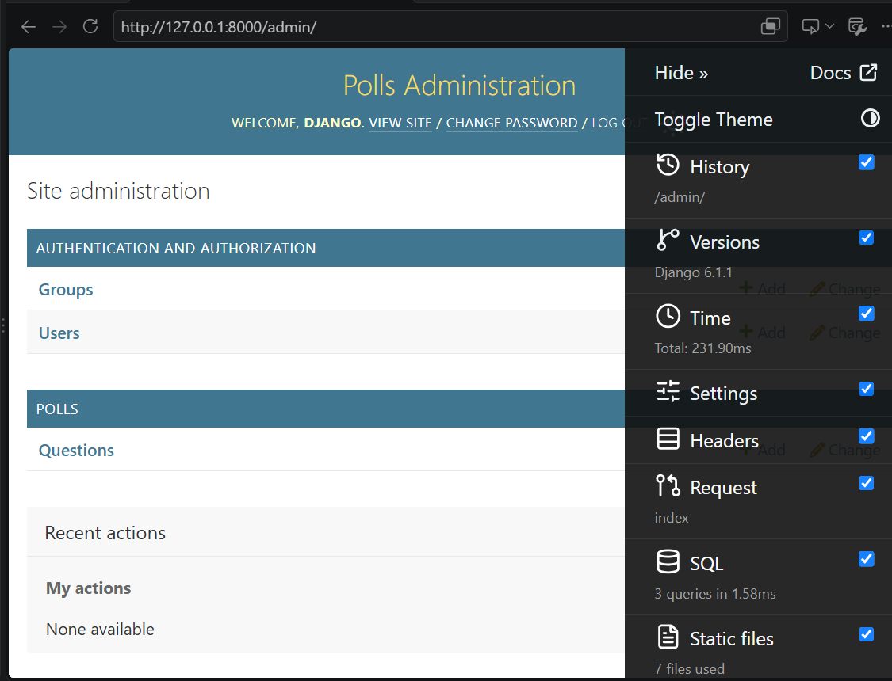

# Installing the Django Debug Toolbar

The Django Debug Toolbar is an essential web debugging tool that helps the developer understand how the application functions. 
It provides pannels that provide debug info about the current request and response. 

## Installation

1. Run:
`python -m pip install django-debug-toolbar`

2. Check for Prequisities 
First, ensure that 'django.contrib.staticfiles' is in the INSTALLED_APPS setting
```
INSTALLED_APPS = [
    # ...
    "django.contrib.staticfiles",
    # ...
]

STATIC_URL = "static/"

```
Second,TEMPLATES setting contains a DjangoTemplates backend whose APP_DIRS options is set to True.

```
TEMPLATES = [
    {
        "BACKEND": "django.template.backends.django.DjangoTemplates",
        "APP_DIRS": True,
        # ...
    }
]
```
3. Install the Application
```
INSTALLED_APPS = [
    # ...
    "debug_toolbar",
    # ...
]
```

4. Add the URLS

```
from django.urls import include, path
from debug_toolbar.toolbar import debug_toolbar_urls

urlpatterns = [
    # ... the rest of your URLconf goes here ...
] + debug_toolbar_urls()

```
5. Add the Middleware 
```
MIDDLEWARE = [
    # ...
    "debug_toolbar.middleware.DebugToolbarMiddleware",
    # ...
]
```
6. Configire Internal IPs

The Debug Toolbar is shown only if your IP address is listed in Django’s INTERNAL_IPS setting. This means that for local development, you must add "127.0.0.1" to INTERNAL_IPS

```

# add this to settings.py 
INTERNAL_IPS = [
    # ...
    "127.0.0.1",
    # ...
]
``` 
7. Disable the Toolbar When Running Tests (optional)

``` 
#asettings.py
TESTING = "test" in sys.argv or "PYTEST_VERSION" in os.environ

if not TESTING:
    INSTALLED_APPS = [
        *INSTALLED_APPS,
        "debug_toolbar",
    ]
    MIDDLEWARE = [
        "debug_toolbar.middleware.DebugToolbarMiddleware",
        *MIDDLEWARE,
    ]

```
```
#urls.py
from django.conf import settings

if not settings.TESTING:
    from debug_toolbar.toolbar import debug_toolbar_urls

    urlpatterns = [
        *urlpatterns,
    ] + debug_toolbar_urls()
    
```
Full installation guide [here.] (https://django-debug-toolbar.readthedocs.io/en/latest/installation.html)


Other helpful packages can be found [here.](https://djangopackages.org/)

And that's it on the POLLS APP!

