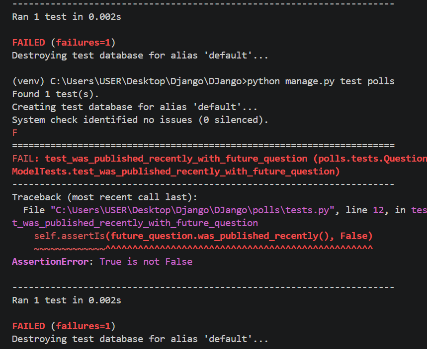
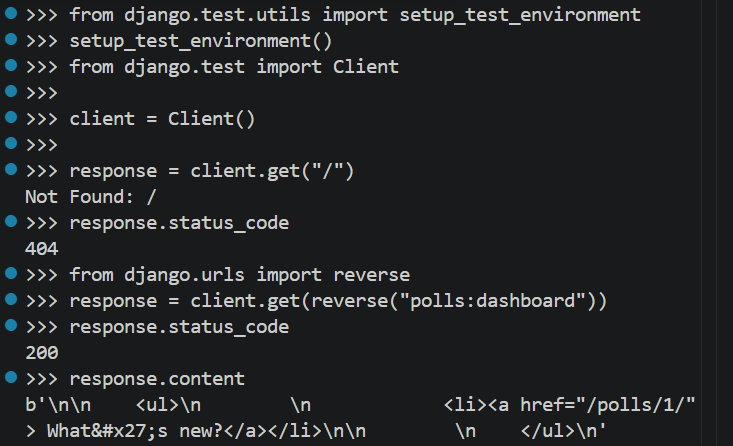
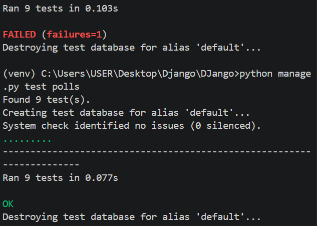

# Automated Testing
Testing is a fundamental practice in development. A good Django developer must be able to write good test code. Like Jacob Kaplan-Moss said, "code without tests is broken by design". 

## Tests for the Polls APP

The polls App has a few bugs that can use testing. First the Question.was_published_recently() method returns True if a question was published within the last day (which is correct), but also shows questions published in the future. 

### Test for the First Bug
Testing is all about checking wheter a method, module is returning the required results. 

In Django, test methods are commonly stored inside tests.py in the app repository itself. The testing sytem automatically checks for functions whose name begin with test.

Django has a class called TestCase that can be used to define test subclasses for different test methods.

It is imported as shown : 

```
#tests.py
import datetime

from django.test import TestCase
from django.utils import timezone

from .models import Question


class QuestionModelTests(TestCase):
    def test_was_published_recently_with_future_question(self):
        """
        was_published_recently() returns False for questions whose pub_date
        is in the future.
        """
        time = timezone.now() + datetime.timedelta(days=30)
        future_question = Question(pub_date=time)
        self.assertIs(future_question.was_published_recently(), False)
```

A test is run by executing:
`python manage.py test polls`
The command looks for tests in the polls application. It then finds the subclass of the django.test.Testcase. 
It creates a special database for the purpose of testing, looks for test methods that begins with test. It runs whatever it's in the function and after, it display whether the test passed or not. 


### Fixing the Bug

The issues is that the function returns True even if the question was published in the future. So to fix that:
```
#models.py
def was_published_recently(self):
    now = timezone.now()
    return now - datetime.timedelta(days=1) <= self.pub_date <= now

``` 
### More Comprehensive Results 
To get real sensible outputs from the function, more tests can be very helpful. More tests help verify and guarantee that the method returns expected output every time even if a change was made.

```
#tests.py 

def test_was_published_recently_with_old_question(self):
    """
    was_published_recently() returns False for questions whose pub_date
    is older than 1 day.
    """
    time = timezone.now() - datetime.timedelta(days=1, seconds=1)
    old_question = Question(pub_date=time)
    self.assertIs(old_question.was_published_recently(), False)


def test_was_published_recently_with_recent_question(self):
    """
    was_published_recently() returns True for questions whose pub_date
    is within the last day.
    """
    time = timezone.now() - datetime.timedelta(hours=23, minutes=59, seconds=59)
    recent_question = Question(pub_date=time)
    self.assertIs(recent_question.was_published_recently(), True)

```
This whole approach of writing tests and then applying fixes is what's called a test-driven development. 

## The Django test client
Django provides a test Client that simulates user interaction with the code at the view level. 
It is imported and used as follows.:

One the shell: 
`python manage.py shell`

```
>>> from django.test.utils import setup_test_environment
>>> setup_test_environment()

```
the setup_test_envrinment() method installs a template renderer which allows additional attributes or responses such as response.context. 

Next, the client class import
```
>>> from django.test import Client
>>> # create an instance of the client for our use
>>> client = Client()
```
Now, giving the client some work
```
>>> # get a response from '/'
>>> response = client.get("/")
Not Found: /
>>> # we should expect a 404 from that address; if you instead see an
>>> # "Invalid HTTP_HOST header" error and a 400 response, you probably
>>> # omitted the setup_test_environment() call described earlier.
>>> response.status_code
404
>>> # on the other hand we should expect to find something at '/polls/'
>>> # we'll use 'reverse()' rather than a hardcoded URL
>>> from django.urls import reverse
>>> response = client.get(reverse("polls:index"))
>>> response.status_code
200
>>> response.content
b'\n    <ul>\n    \n        <li><a href="/polls/1/">What&#x27;s up?</a></li>\n    \n    </ul>\n\n'
>>> response.context["latest_question_list"]
<QuerySet [<Question: What's up?>]>
```


### Improving the Views
Limiting view to include only published questions and not future ones.
```
#views.py
class IndexView(generic.ListView):
    template_name = "polls/index.html"
    context_object_name = "latest_question_list"

    def get_queryset(self):
        """Return the last five published questions."""
        return Question.objects.order_by("-pub_date")[:5]
```
updating the get_queryset() method:
```
def get_queryset(self):
    """
    Return the last five published questions (not including those set to be
    published in the future).
    """
    return Question.objects.filter(pub_date__lte=timezone.now()).order_by("-pub_date")[
        :5
    ]

``` 
Now, it returns a queryset containing questions whose publication date is less than or equal to - timezone.now()
### Testing the new view

Now, to simplify the process with tests.py. 
```
def create_question(question_text, days):
    """
    Create a question with the given `question_text` and published the
    given number of `days` offset to now (negative for questions published
    in the past, positive for questions that have yet to be published).
    """
    time = timezone.now() + datetime.timedelta(days=days)
    return Question.objects.create(question_text=question_text, pub_date=time)


class QuestionIndexViewTests(TestCase):
    def test_no_questions(self):
        """
        If no questions exist, an appropriate message is displayed.
        """
        response = self.client.get(reverse("polls:index"))
        self.assertEqual(response.status_code, 200)
        self.assertContains(response, "No polls are available.")
        self.assertQuerySetEqual(response.context["latest_question_list"], [])

    def test_past_question(self):
        """
        Questions with a pub_date in the past are displayed on the
        index page.
        """
        question = create_question(question_text="Past question.", days=-30)
        response = self.client.get(reverse("polls:index"))
        self.assertQuerySetEqual(
            response.context["latest_question_list"],
            [question],
        )

    def test_future_question(self):
        """
        Questions with a pub_date in the future aren't displayed on
        the index page.
        """
        create_question(question_text="Future question.", days=30)
        response = self.client.get(reverse("polls:index"))
        self.assertContains(response, "No polls are available.")
        self.assertQuerySetEqual(response.context["latest_question_list"], [])

    def test_future_question_and_past_question(self):
        """
        Even if both past and future questions exist, only past questions
        are displayed.
        """
        question = create_question(question_text="Past question.", days=-30)
        create_question(question_text="Future question.", days=30)
        response = self.client.get(reverse("polls:index"))
        self.assertQuerySetEqual(
            response.context["latest_question_list"],
            [question],
        )

    def test_two_past_questions(self):
        """
        The questions index page may display multiple questions.
        """
        question1 = create_question(question_text="Past question 1.", days=-30)
        question2 = create_question(question_text="Past question 2.", days=-5)
        response = self.client.get(reverse("polls:index"))
        self.assertQuerySetEqual(
            response.context["latest_question_list"],
            [question2, question1],
        )
```

- test_no_questions - doesn't create question but checks for messages susch as "No polls available"
- test_past_question - creates a question and verify that it appears in the list
- test_future_question - creat a question the future and check whether it is displayed.

>> each test meto resets the database, so the first question is no longer ther, ans so again the index shouldn't have any questions in it. 

### Testing the DetailView
Even if the questions don't show in the dashboard, the user can still reach them if they know or guess the url.
A similar constraint is also needed for the DetailView.
```
class DetailView(generic.DetailView):
    ...

    def get_queryset(self):
        """
        Excludes any questions that aren't published yet.
        """
        return Question.objects.filter(pub_date__lte=timezone.now())
``` 
Then a test to check that a question whose pub_date is in the past can be displayed and one in the future shouldn't.
```
class QuestionDetailViewTests(TestCase):
    def test_future_question(self):
        """
        The detail view of a question with a pub_date in the future
        returns a 404 not found.
        """
        future_question = create_question(question_text="Future question.", days=5)
        url = reverse("polls:detail", args=(future_question.id,))
        response = self.client.get(url)
        self.assertEqual(response.status_code, 404)

    def test_past_question(self):
        """
        The detail view of a question with a pub_date in the past
        displays the question's text.
        """
        past_question = create_question(question_text="Past Question.", days=-5)
        url = reverse("polls:detail", args=(past_question.id,))
        response = self.client.get(url)
        self.assertContains(response, past_question.question_text)

```

Other test that can be added:
- get_queryset in ResultsView
- Question should only be displayed if they have related choices
- logged in admins can see unpublished questions but normal users shouldn't. 
### Valuable testing tools
- solenium 
- LiverServerTestCse 


